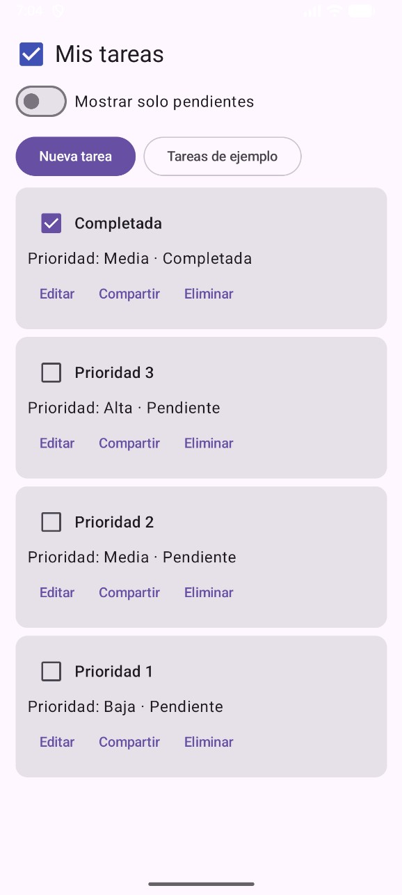
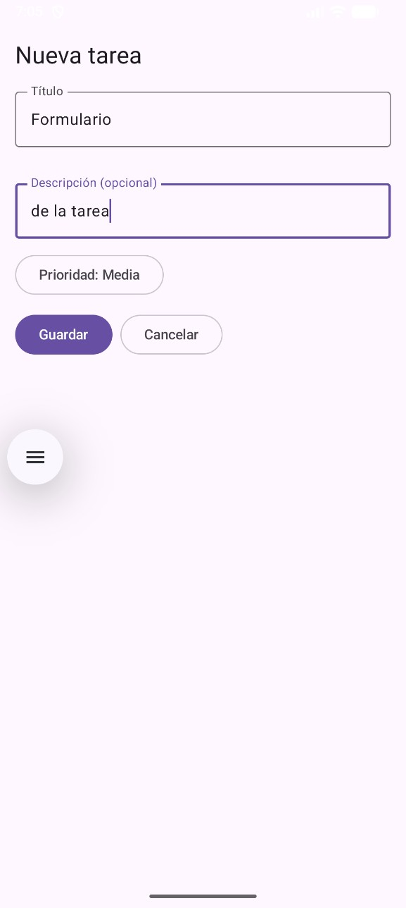
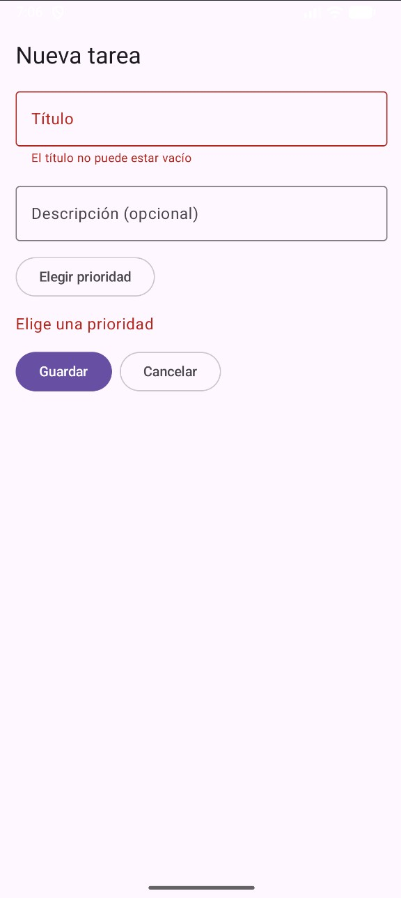
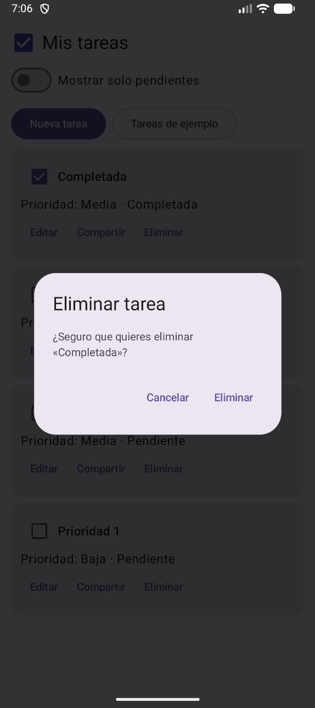
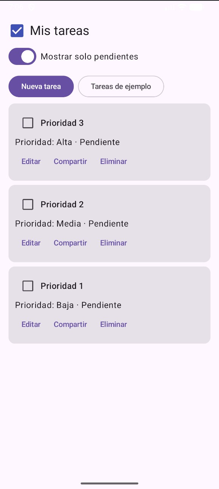
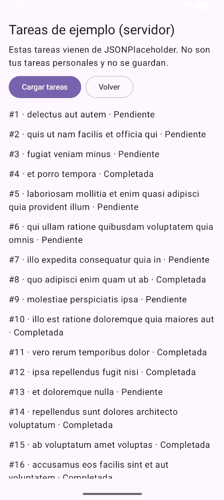
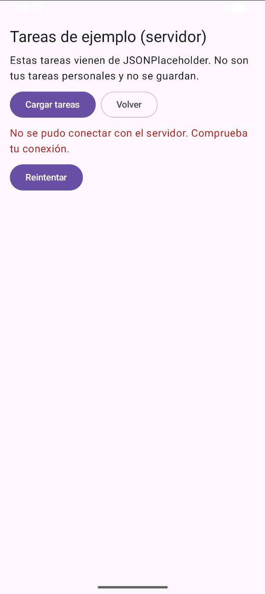
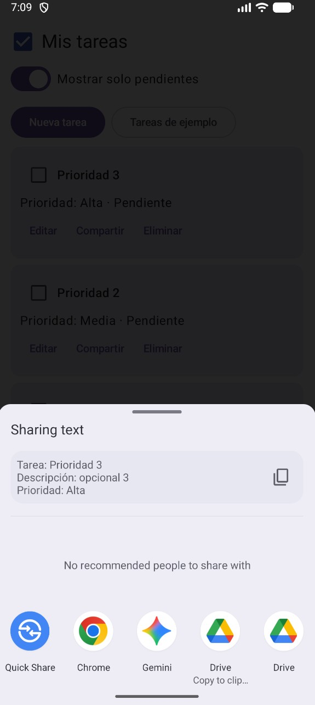
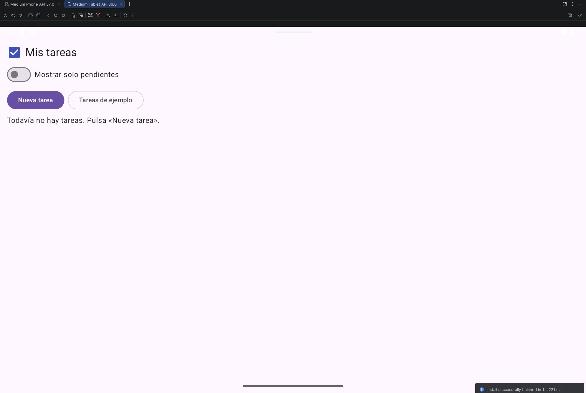

# Gestor Personal de Tareas

Aplicación Android para organizar tareas personales, académicas o profesionales.
Permite crear, consultar, editar, completar, eliminar y compartir tareas, que se guardan
de forma permanente en el dispositivo. Además consulta tareas de ejemplo de un servicio web REST.

Práctica del módulo **Programación Multimedia y Dispositivos Móviles (PMDM)**.

---

## Funcionalidades implementadas

- **Listado de tareas** con `LazyColumn`: título, prioridad y estado (pendiente/completada) de cada tarea.
  Si no hay tareas se muestra un mensaje informativo.
- **Crear tarea**: formulario con título, descripción, prioridad (menú desplegable), Guardar y Cancelar.
- **Validación**:
  - el título no puede estar vacío ni tener solo espacios;
  - el título debe tener al menos 3 caracteres tras eliminar los espacios exteriores;
  - la prioridad debe ser Baja, Media o Alta;
  - la descripción puede estar vacía.
  Los errores se muestran junto al campo. El botón Guardar se desactiva mientras se guarda para evitar duplicados.
- **Editar tarea**: el mismo formulario se abre con los datos actuales.
- **Marcar como completada** con un `Checkbox`.
- **Eliminar** con un `AlertDialog` de confirmación. Si se cancela, la tarea no cambia.
- **Persistencia con Room**: todas las operaciones se guardan en la base de datos local.
- **Filtro «Mostrar solo pendientes»** con un `Switch`. La preferencia se guarda con Preferences DataStore
  y se recupera al volver a abrir la app (valor inicial: mostrar todas).
- **Tareas de ejemplo (API REST)**: consulta `GET /todos?userId=1` de JSONPlaceholder con Retrofit y coroutines.
  Muestra indicador de carga, la lista recibida (id, título y estado), mensaje de error y botón Reintentar.
  El botón de carga se desactiva durante la petición. Estas tareas no se guardan en Room.
- **Compartir tarea** con un Intent implícito `ACTION_SEND` y el selector de aplicaciones.
  Si no hay ninguna app compatible se muestra un aviso. La app no afirma que el envío se haya realizado.

---

## Organización del proyecto

```
app/app/src/main/java/com/example/practica_gestor_personal_de_tareas/
├── MainActivity.kt            Única actividad y navegación sencilla basada en estado
├── datos/                     Modelo y almacenamiento (Room)
│   ├── Tarea.kt               Modelo de tarea y entidad de la tabla "tareas"
│   ├── TareaDao.kt            Consultar, insertar, actualizar y eliminar
│   └── AppDatabase.kt         Base de datos (instancia única)
├── preferencias/
│   └── Ajustes.kt             Preferencia "solo pendientes" con DataStore
├── red/                       Comunicaciones (Retrofit)
│   ├── TareaRemota.kt         Modelo del JSON recibido
│   └── ApiTareas.kt           Interfaz de la API y cliente Retrofit
└── ui/                        Interfaz (Jetpack Compose)
    ├── PantallaLista.kt       Pantalla principal, filtro, diálogo de borrado
    ├── PantallaFormulario.kt  Crear/editar tarea y validación
    ├── PantallaApi.kt         Tareas de ejemplo del servidor
    ├── Compartir.kt           Intent ACTION_SEND
    └── theme/                 Tema generado por Android Studio
```

La navegación no usa ninguna biblioteca: una variable de estado (`pantalla`) decide qué pantalla
se muestra (`lista`, `formulario` o `api`) y `BackHandler` gestiona el botón Atrás.

---

## Bibliotecas utilizadas

| Biblioteca | Versión | Uso |
|---|---|---|
| Jetpack Compose + Material 3 | BOM del proyecto | Interfaz |
| Room (`room-runtime`, `room-ktx`, `room-compiler`) | 2.8.4 | Base de datos local |
| KSP | 2.3.14 | Generación de código de Room |
| DataStore Preferences | 1.1.7 | Preferencia del filtro |
| Retrofit + Converter Gson | 3.0.0 | Consumo de la API REST |
| Kotlin Coroutines | incluidas en el proyecto | Operaciones asíncronas |

Permisos: solo `android.permission.INTERNET` (necesario para la API). No se solicita ningún otro permiso.

---

## Instrucciones para ejecutar

1. Clonar el repositorio.
2. Abrir la carpeta **`app`** (la que contiene `settings.gradle.kts`) con Android Studio.
3. Esperar a que termine **Gradle Sync**.
4. Iniciar un emulador o conectar un dispositivo con Android 7.0 (API 24) o superior.
5. Pulsar **Run**.

APK de depuración: [`Build/app-debug.apk`](Build/app-debug.apk).
Para generarlo de nuevo: *Build → Build App Bundle(s) / APK(s) → Build APK(s)*
o `gradlew.bat assembleDebug` desde la carpeta `app`.
El resultado aparece en `app/app/build/outputs/apk/debug/app-debug.apk`.

Entorno: Android Studio Rabbit 2 | 2026.2.2 Patch 1, AGP 9.5.2, Gradle 9.6.0, Kotlin 2.2.10,
compileSdk/targetSdk 37, minSdk 24.

---

## Emuladores utilizados

| | Emulador 1 (pantalla compacta) | Emulador 2 (pantalla grande) |
|---|---|---|
| Perfil (genérico de Android Studio) | Medium Phone | Medium Tablet |
| Tamaño de pantalla | 6,4" | 10,05" |
| Resolución | 1080 × 2400 | 2560 × 1600 |
| Densidad | 420 dpi | 320 dpi (xhdpi) |
| Versión de Android / API | Android 17 / API 37.0 | Android 16 / API 36 |
| Versión del emulador | 37.2.13 | 37.2.13 |

---

## Pruebas realizadas

Estado: ✅ correcto · ❌ incidencia · ⏳ pendiente

| Nº | Prueba | Resultado esperado | Resultado obtenido | Emu. 1 | Emu. 2 |
|---|---|---|---|---|---|
| 1 | Crear una tarea válida | Se guarda y aparece en la lista | La tarea se guarda y aparece en la lista. | ✅ | ✅ |
| 2 | Intentar guardar un título vacío | Se muestra un error y no se crea la tarea | Aparece «El título no puede estar vacío» y no se crea la tarea. | ✅ | ✅ |
| 3 | Editar una tarea | Los cambios se muestran correctamente | Se muestran el nuevo título, descripción y prioridad. | ✅ | ✅ |
| 4 | Marcar una tarea como completada | Su estado cambia y queda guardado | Cambia a «Completada» y se mantiene tras reiniciar. | ✅ | ✅ |
| 5 | Cancelar una eliminación | La tarea no desaparece | Se cierra el diálogo y la tarea sigue en la lista. | ✅ | ✅ |
| 6 | Eliminar una tarea confirmando | La tarea desaparece de la base de datos | La tarea desaparece y no vuelve tras reiniciar. | ✅ | ✅ |
| 7 | Cerrar y volver a abrir la aplicación | Se recuperan las tareas guardadas | Al reabrir aparecen todas las tareas guardadas. | ✅ | ✅ |
| 8 | Activar el filtro y reiniciar | Se conserva la preferencia seleccionada | El Switch sigue activado y solo se ven las pendientes. | ✅ | ✅ |
| 9 | Consultar la API con Internet | Se muestran las tareas recibidas | Se muestran 20 tareas con id, título y estado. | ✅ | ✅ |
| 10 | Consultar la API sin conexión | Se muestra un error y se permite reintentar | Aparece el mensaje de error y el botón «Reintentar»; al reconectar carga bien. | ✅ | ✅ |
| 11 | Compartir una tarea | Se abre el selector de aplicaciones compatibles | Se abre el selector «Compartir tarea» con las apps disponibles. | ✅ | ✅ |
| 12 | Cambiar la orientación del dispositivo | La app sigue funcionando y conserva sus datos | Se conservan los datos, la pantalla actual y el texto del formulario. | ✅ | ✅ |

---

## Capturas de pantalla

| Listado principal | Formulario de creación |
|---|---|
|  |  |

| Error de validación | Confirmación de borrado |
|---|---|
|  |  |

| Filtro «solo pendientes» | API: tareas de ejemplo |
|---|---|
|  |  |

| API: sin conexión | Compartir |
|---|---|
|  |  |

| Pantalla grande |
|---|
|  |

---

## Uso de IA

Chats de IA utilizados durante el desarrollo:

- [Chat de desarrollo (ChatGPT)](https://chatgpt.com/share/6b05eed2-4ccc-83eb-9c10-dc71f11d1fe3)

---

## Incidencias conocidas y limitaciones

- Las tareas de ejemplo de la API no se guardan: al girar la pantalla o salir de ella hay que volver a cargarlas.
- Los errores al marcar como completada o al eliminar una tarea no se muestran al usuario
  (solo se controlan los errores al guardar desde el formulario).
- Al abrir la app, el filtro «Mostrar solo pendientes» puede mostrar todas las tareas durante
  un instante hasta que DataStore lee el valor guardado.
- Si el servidor devolviera un JSON con un formato inesperado, ese error no está controlado
  (solo se controlan la falta de conexión y los errores HTTP).
- Los textos de la interfaz están escritos en el código y no en strings.xml, por lo que la app no está preparada para traducirse.
- La base de datos está en la versión 1 y no tiene migraciones: si se cambia la entidad Tarea habría que añadirlas.
